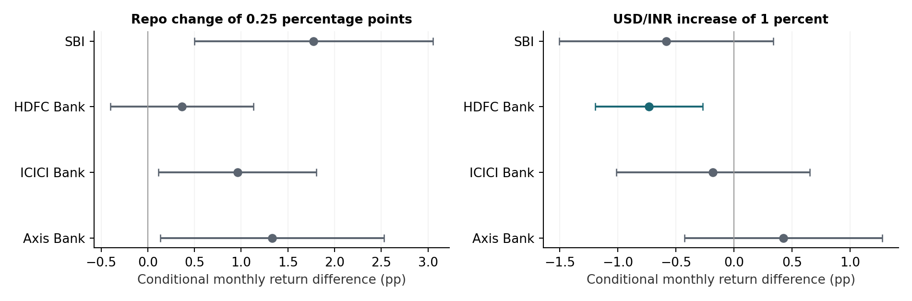
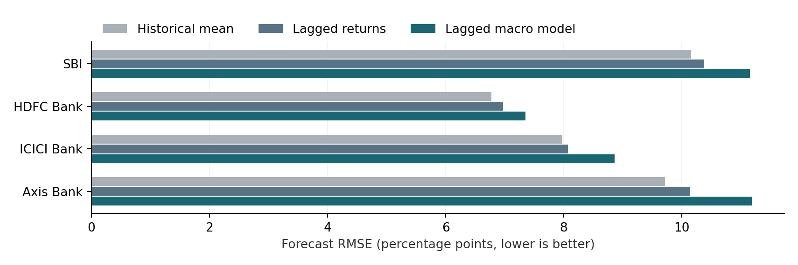

# Indian Banking Stock Returns and Macroeconomic Conditions

Shabadneet Singh Bhatia | Independent empirical research | Updated 12 November 2026

An observational study of SBI, HDFC Bank, ICICI Bank and Axis Bank against NIFTY 50, using monthly returns from 2010 to 2025 and macroeconomic models from 2015 to 2025.

### Abstract

Broad-market co-movement is the most consistent relationship in this study. Bank-specific macroeconomic associations add modest explanatory information, but the tested models do not improve historical forecasts. The descriptive dataset contains 960 instrument-month rows across four banks and NIFTY 50. The common regression sample comprises 131 months per bank, February 2015 to December 2025. Bank-specific OLS models control for contemporaneous market returns and use Newey-West standard errors. Of 16 same-month macro coefficients, only HDFC Bank's negative USD/INR coefficient survives both Benjamini-Hochberg and Holm correction at 5 percent. SBI's repo-change coefficient remains positive across the reported year-exclusion exercises but narrowly misses the 16-test false-discovery threshold. A 60-observation expanding-window forecasting exercise produces 70 monthly forecasts per bank. Fully lagged macro models have higher root mean squared error than a historical-average forecast for all four banks. Correcting event-window endpoints strengthens the SBI market-relative event result, but it narrowly misses correction across all 27 corrected event tests. These results support a cautious descriptive account of bank-specific exposures, rather than causal policy effects or a profitable prediction rule.

### Research question and contribution

How much do repo-rate conditions, India VIX and USD/INR add to an account of banking-stock returns once broad-market movements are included? Does information available by the preceding month improve the prediction of subsequent returns?

The contribution is a reproducible comparison of four banks that separates same-month explanation from retrospective forecasting. The extension adds explicit test families, calendar-aware exclusion inference, corrected event endpoints, specification sensitivity and a fixed forecasting protocol. All extensions were designed after the original results were available and are exploratory; they are not preregistered confirmation.

### Main findings

| Question | Finding |
| --- | --- |
| Market co-movement | Positive conditional market coefficients for all four banks |
| Macro evidence | HDFC exchange-rate association survives 16-test corrections |
| Forecasting | Lagged macro models underperform the historical mean in all banks |
| RBI events | Corrected SBI relative result depends on the testing family |

## Data and Empirical Design

### Samples and measurement

| Component | Coverage | Interpretation |
| --- | --- | --- |
| Descriptive stock history | 2010-01 to 2025-12 | 192 returns per instrument; five instruments |
| Common macro models | 2015-02 to 2025-12 | 131 months per bank; not 524 independent macro months |
| 2020 exclusion | Omit 2020-03 to 2020-12 | 121 retained months per bank |
| Historical forecasts | 2020-03 to 2025-12 | 70 forecasts per bank after 60 training observations |
| Existing daily event study | 26 rate changes in 2015-2025 | 18 cuts and eight hikes; effective-date windows |

Monthly percentage returns equal 100 times the ratio of successive month-end closes minus 100. The stored equity download script explicitly requests yfinance auto_adjust=True. That establishes the intended adjustment setting, but does not independently reconcile each saved price, corporate action or dividend against another vendor. NIFTY 50 is the stored index benchmark; comparisons should not be described as audited total-return outperformance. Four selected surviving banks do not represent the entire Indian banking sector.

| Regressor | Definition and unit |
| --- | --- |
| Repo level | Policy repo rate in percent |
| Repo change | Monthly rate difference in percentage points |
| NIFTY return | Current-month benchmark return in percent |
| India VIX mean | Mean of daily closing VIX index levels within month |
| USD/INR change | Monthly percentage increase; positive means rupee depreciation |
| Original lagged VIX | Previous month-end close, not lagged monthly mean |

### Models and inference

The baseline includes an intercept, repo level, repo change and NIFTY return. The same-month model adds mean India VIX and USD/INR change. The original partially lagged model substitutes the prior VIX close and prior FX change while retaining current-month baseline regressors. These three specifications use identical observations and HAC standard errors with three Bartlett lags and no small-sample multiplier.

The main reporting family contains 16 same-month macro coefficients: four banks times four macro factors, excluding the market control. Both Benjamini-Hochberg false-discovery q-values and Holm adjusted p-values are reported. A broader sensitivity family includes all 40 macro coefficients across the three original specifications. Holm protects against arbitrary dependence within a specified family; choosing a family after seeing results limits confirmatory interpretation. New sensitivity exercises are not additional independent confirmations.

A monetary-policy surprise is distinct from an observed rate change. Bernanke and Kuttner (2004) motivate isolating unanticipated policy news. This study lacks such a surprise measure and does not identify causal monetary-policy effects.

## Contemporaneous Results and Multiple Testing

### Market co movement and incremental fit

| Bank | Market beta | Expanded R2 | Change adj R2 | Joint Holm p |
| --- | --- | --- | --- | --- |
| SBI | 1.239 | 0.492 | 0.007 | 0.336 |
| HDFC Bank | 0.909 | 0.633 | 0.016 | 0.023 |
| ICICI Bank | 1.200 | 0.582 | 0.002 | 0.336 |
| Axis Bank | 1.428 | 0.598 | 0.001 | 0.336 |

Added-factor joint tests concern VIX and USD/INR together, conditional on repo variables and NIFTY. Holm adjustment covers four bank-level joint tests.

Market coefficients range from 0.909 to 1.428 and each has HAC p < 0.001. Adding VIX and FX raises adjusted R2 by only 0.001 to 0.016. HDFC is the only bank with a jointly detectable VIX/FX contribution after four-test Holm adjustment (p = 0.023). This is conditional in-sample information, not future predictive accuracy.

### Selected macro coefficients

| Bank and factor | Beta | 95 percent CI | Raw p | BH q 16 | Holm p 16 |
| --- | --- | --- | --- | --- | --- |
| SBI repo change | 7.102 | [1.991, 12.213] | 0.006 | 0.052 | 0.097 |
| HDFC FX change | -0.733 | [-1.197, -0.269] | 0.002 | 0.031 | 0.031 |
| HDFC repo level | 0.515 | [0.000, 1.031] | 0.050 | 0.133 | 0.564 |
| ICICI repo change | 3.836 | [0.453, 7.220] | 0.026 | 0.117 | 0.368 |
| ICICI VIX mean | -0.133 | [-0.264, -0.002] | 0.047 | 0.133 | 0.564 |
| Axis repo change | 5.329 | [0.538, 10.119] | 0.029 | 0.117 | 0.380 |

All 16 coefficients, including nonsignificant ones, appear in macro_multiple_testing.csv. Intervals are unadjusted HAC intervals; they are not simultaneous confidence bands.

A 0.25 percentage-point repo increase corresponds to an estimated 1.776 percentage-point SBI return difference in the same month, conditional on the model. A 1 percent USD/INR increase corresponds to a 0.733 percentage-point lower HDFC return. In the broader 40-test family HDFC retains BH significance (q = 0.026), but not Holm significance (p = 0.076). SBI has BH q = 0.065 in that family.

## Sensitivity and Stability

### Excluding the pandemic window

| Factor | Full beta | Exclusion beta | Exclusion raw p |
| --- | --- | --- | --- |
| SBI repo change | 7.102 | 7.470 | 0.016 |
| HDFC FX change | -0.733 | -0.789 | <0.001 |
| ICICI repo change | 3.836 | 2.609 | 0.141 |
| ICICI VIX | -0.133 | -0.047 | 0.707 |
| Axis repo change | 5.329 | 2.174 | 0.396 |

New exclusion estimates use calendar-aware HAC(3). Omitted months retain their actual temporal distance; months on opposite sides of a gap are not treated as consecutive.

The SBI repo-change and HDFC FX coefficients retain their signs and nominal significance in this exclusion exercise. ICICI repo/VIX and Axis repo-change evidence weakens. This sensitivity was already present in the original study; the extension reproduces point estimates while improving covariance handling across omitted months. None of the sensitivity p-values in this section is multiplicity-adjusted.

### Bandwidth and year exclusions

For SBI repo change, nominal p-values range from 0.0019 to 0.0292 across HAC lag choices 0, 1, 3, 6 and 12. For HDFC FX, the range is 0.0019 to 0.0040. Removing each year from 2015 through 2025 in turn leaves the SBI coefficient positive, between 5.689 and 8.021; raw p-values range from 0.0045 to 0.0478. HDFC remains negative, between -0.825 and -0.466, but omitting 2018 yields p = 0.062. Its significance is therefore not uniform across all year exclusions.

### Alternative specifications and diagnostics

Removing the persistent repo-level regressor leaves the SBI repo-change coefficient positive (7.577, p = 0.002) and HDFC FX negative (-0.744, p = 0.0015). Replacing VIX mean with the stored monthly VIX change also retains those signs. These are exploratory specification comparisons, not selected replacements for the original model. The VIX-change variable uses index-point changes.

The maximum variance inflation factor is 1.495 in each bank model, indicating limited regressor collinearity in this sample. Cook distance identifies April 2020 as SBI's most influential observation, March 2020 for HDFC and Axis, and October 2018 for ICICI. Influential observations are retained in the main estimates.

### Exploratory change in coefficients around 2020

A joint HAC Wald test permits both intercept and all five slopes to differ from January 2020, with 59 pre-break and 72 post-break months. Raw p-values range from 0.296 to 0.501; all four Holm adjusted p-values equal 1.000. The tests do not detect a break at that selected boundary. Limited power means this is not proof that exposures are constant, nor does it contradict sensitivity to deleting a few unusual months.

## Historical Forecast Evaluation

### Information available at each forecast origin

The original partially lagged models still include current-month NIFTY returns and cannot establish forecasting performance. The new exercise predicts each bank's current-month return using only values observed by the preceding calendar month. After forming lags, 130 usable observations remain. The first 60 train the initial model; the training window expands by one month for each of 70 forecasts from March 2020 through December 2025.

Three forecasts share the same training targets and evaluation months. The historical mean uses the expanding training average. The lagged-return model uses previous bank and NIFTY returns. The lagged-macro model adds previous repo level, repo change, VIX mean and FX change. Parameters are re-estimated at every origin. No predictor scaling, tuning or variable selection uses future observations. A test perturbs current and future data and confirms the earlier forecast stays unchanged.

| Bank | Mean RMSE | Returns RMSE | Macro RMSE | Macro OOS R2 |
| --- | --- | --- | --- | --- |
| SBI | 10.160 | 10.368 | 11.151 | -0.205 |
| HDFC Bank | 6.776 | 6.974 | 7.347 | -0.176 |
| ICICI Bank | 7.977 | 8.068 | 8.862 | -0.234 |
| Axis Bank | 9.716 | 10.130 | 11.183 | -0.325 |

RMSE is in percentage points. OOS R2 = 1 - model squared-error sum / historical-mean squared-error sum. Negative values indicate worse performance than the mean benchmark.

### Interpretation and scope

Every lagged-macro model has higher RMSE than both comparison models. Macro OOS R2 ranges from -0.176 to -0.325. This historical protocol provides no evidence of useful forecast improvement from this linear predictor set. It does not establish that all macro models or all forecasting horizons fail.

The evaluation begins with the pandemic and has only 70 forecasts per bank. The protocol was chosen retrospectively after the dataset was known, so these are expanding-origin historical evaluations, not a pristine untouched test or a live forward trial. No claim of a statistically significant forecast difference, trading profitability or performance after transaction costs is made. The historical snapshot also does not reconstruct every data-provider revision available at each past date.

## RBI Effective Date Events

### Correcting the event window endpoints

The daily study contains 26 policy effective-date changes: 18 cuts and eight hikes. The legacy code labeled a ratio of the close at t plus 1 to the close at t minus 1 as a three-day return. That ratio contains two daily returns. Its eleven-day counterpart contains ten. To compound daily returns from t minus 1 through t plus 1 inclusive, the denominator must be the close at t minus 2; for t minus 5 through t plus 5, it must be the close at t minus 6. The event-day return is unchanged.

The extension recomputes these inclusive windows from the same frozen daily files and event dates. It preserves the legacy tables for comparison and records actual start and end close dates for every event. No overlapping return windows are detected among these 26 events for the corrected one-, three- and eleven-day definitions. This narrow calculation correction is separate from any independent source or announcement-calendar audit.

| SBI event measure | Legacy mean | Corrected mean | Corrected raw p |
| --- | --- | --- | --- |
| Three day raw return | -1.107 percent | -1.332 percent | 0.0217 |
| Three day bank minus index | -0.804 pp | -1.270 pp | 0.00204 |
| Eleven day raw return | -1.207 percent | -1.045 percent | 0.3962 |
| Eleven day bank minus index | -1.586 pp | -1.835 pp | 0.1117 |

Corrected windows include three or eleven close-to-close daily returns respectively. Legacy means describe two or ten return intervals.

### Multiplicity and interpretation

The corrected SBI three-day bank-minus-index mean has a 95 percent interval from -2.030 to -0.510 percentage points. Both BH and Holm adjustment across the 12 corrected bank-minus-index tests yield 0.0244. Across all 27 corrected raw and relative tests, the adjusted value is 0.0550, narrowly above 5 percent. When legacy alternative endpoints are included as well, the 45-test Holm value is 0.0916. The corrected SBI raw return does not survive its 15-test family correction (adjusted value 0.3255). The result is stronger than the legacy calculation, but sensitive to the stated testing family.

### Identification limits

These effective dates need not coincide with the time new information reached investors. Anticipated changes may already be priced. Bank-minus-index returns subtract the index without estimating a bank-specific market beta and are not risk-adjusted abnormal returns. The selected sample includes rate changes rather than all policy meetings, and concurrent firm or macroeconomic news may matter. Nonoverlapping windows do not establish independence. The study does not identify a causal policy surprise.

### Integrated conclusion

The evidence supports broad-market commonality and heterogeneous conditional bank exposures. HDFC FX is the clearest same-month macro association under the 16-test family; SBI repo change is sign-stable but misses that adjusted threshold. Corrected SBI event evidence depends on the testing family. The tested fully lagged models do not improve historical forecast accuracy. These distinctions make the results more useful without overstating what the design can establish.

## Historical Context and Original Analyses

### Return distributions over 2010 to 2025

| Instrument | Monthly mean percent | Monthly SD percent | Minimum percent | Maximum percent |
| --- | --- | --- | --- | --- |
| SBI | 1.3305 | 9.7276 | -35.0330 | 38.3020 |
| HDFC Bank | 1.5449 | 6.1875 | -26.8119 | 21.7397 |
| ICICI Bank | 1.5755 | 8.5378 | -34.8919 | 31.7680 |
| Axis Bank | 1.4864 | 9.4812 | -45.6475 | 33.0343 |
| NIFTY 50 | 0.9560 | 4.7107 | -23.2464 | 14.6800 |

Original descriptive results; 192 monthly observations per instrument. Arithmetic means and sample standard deviations are not annual compound returns or risk-adjusted performance measures.

ICICI has the highest arithmetic monthly mean among these stored series. SBI has the highest monthly standard deviation; all four banks have higher sample volatility than NIFTY 50. No formal outperformance claim follows from differences in these descriptive means. All results describe this selected historical sample.

### Repo only associations and market controls

| Instrument | Repo level correlation | Repo change correlation | Single factor change p |
| --- | --- | --- | --- |
| SBI | -0.1138 | 0.2371 | 0.0819 |
| HDFC Bank | -0.0122 | 0.1377 | 0.4162 |
| NIFTY 50 | -0.1147 | 0.1601 | 0.4081 |

Original February 2015 to December 2025 results; 131 observations per instrument. Single-factor p-values use HAC(3).

Repo-level correlations are small. The original single-factor repo-change coefficients do not reach the nominal 5 percent threshold. Adding NIFTY changes the conditional association: SBI's repo-change coefficient is 8.036 (p = 0.001), while HDFC's is 0.462 (p = 0.773). These baseline results differ from the expanded VIX/FX models because their conditioning information differs.

### Original lag comparisons

Replacing current repo change with its previous-month value yielded SBI coefficient 3.027 (p = 0.586) and HDFC coefficient -2.863 (p = 0.0117), each on 130 months. These exploratory tests used contemporaneous NIFTY controls and a slightly different sample. The HDFC repo lag should not be conflated with the original lagged VIX/FX coefficients, which were individually insignificant at the nominal 5 percent level. The new fully lagged forecasting exercise directly evaluates a separate information set.

### Boundaries of the evidence

The four-bank design is descriptive, with no causal identification or random sample of banks. Inflation, bank balance-sheet fundamentals, liquidity, crude oil and policy-surprise measures are absent. Source reconciliation and announcement timestamps remain outside the completed work. Adding many more predictors to 131 months without a clear mechanism and evaluation protocol could increase overfitting. Further progress should prioritize better identification and independent data reconciliation rather than a larger list of regressions.

## Reproducibility and References

### Source and completed execution

Source repository: https://github.com/ssbdesign/indian-fin-risk. Frozen source commit: 9ca8395a8783da44602ca3e9ee531d291321f7f0 on feature/india-vix-usdinr-analysis. The extension reads the existing analysis dataset, daily prices and event-test tables without downloading prices or changing input datasets.

All 12 original model specifications were re-estimated. Every reported coefficient, p-value, HAC standard error and R2 matches the committed table within its four-decimal precision. The extension saves full-precision outputs, input SHA-256 hashes and dependency versions in reports/v2/results/run_manifest.json. New numerical tests cover covariance equivalence on contiguous months, correct spacing across omitted months, and the forecast information boundary. The existing macro-factor tests remain in the test suite.

| Action | Command from project root |
| --- | --- |
| Run the extension | python src/run_research_v2.py |
| Generate final charts | python src/plot_research_v2.py |
| Run numerical and macro tests | python -m pytest -q tests |

The new outputs are isolated under reports/v2. Original results and data remain available. Statistical tables use unrounded internal values.

### Selected output files

macro_multiple_testing.csv and all_model_multiple_testing.csv report all tested macro coefficients and corrections. joint_added_factors.csv reports robust joint tests. sensitivity.csv records every bandwidth, year exclusion and alternative specification. break_tests.csv contains selected-boundary tests. forecast_predictions.csv and forecast_metrics.csv expose all predictions and errors. event_multiple_testing.csv records legacy tests; corrected_event_tests.csv and corrected_event_detail.csv document inclusive event windows. event_endpoint_sensitivity.csv reports the 45-test endpoint family. diagnostics.csv and reproduction.csv retain the numerical evidence behind the report.

### References

Bernanke, B. S., and Kuttner, K. N. (2004). What Explains the Stock Market's Reaction to Federal Reserve Policy? FEDS 2004-16. Federal Reserve Board. https://www.federalreserve.gov/pubs/feds/2004/200416/200416abs.html

Newey, W. K., and West, K. D. (1987). A Simple, Positive Semi-definite, Heteroskedasticity and Autocorrelation Consistent Covariance Matrix. Econometrica 55(3), 703-708. https://doi.org/10.2307/1913610

Benjamini, Y., and Hochberg, Y. (1995). Controlling the False Discovery Rate: A Practical and Powerful Approach to Multiple Testing. Journal of the Royal Statistical Society Series B 57(1), 289-300. https://doi.org/10.1111/j.2517-6161.1995.tb02031.x

Holm, S. (1979). A Simple Sequentially Rejective Multiple Test Procedure. Scandinavian Journal of Statistics 6(2), 65-70.

National Stock Exchange of India. India VIX definition and NIFTY 50 overview. https://www.nseindia.com/static/products-services/indices-indiavix-index ; https://www.nseindia.com/static/products-services/indices-nifty50-index

Reserve Bank of India. Historical monetary-policy rate material and Reference Rate Archive. https://www.rbi.org.in/Scripts/bs_viewcontent.aspx?Id=624 ; https://www.rbi.org.in/scripts/ReferenceRateArchive.aspx

statsmodels documentation. Multiple-testing corrections. https://www.statsmodels.org/stable/generated/statsmodels.stats.multitest.multipletests.html
